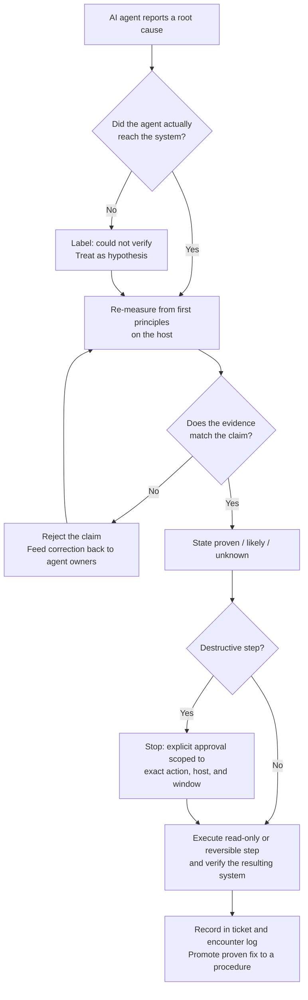

# AI-Assisted Operations Playbook

Guardrails and proven procedures for running production infrastructure work with AI agents —
without letting the agent's confidence stand in for evidence.

This playbook grew out of day-to-day site reliability work done through LLM agents (GitHub Copilot CLI,
an AI SRE agent, and an AI incident-triage bot) across a large Linux, Kubernetes, and NGINX fleet. It
records the failure patterns that kept recurring — in the people *and* in the agents — and the concrete
corrections that fixed them.

## What's here

| Path | Contents |
|---|---|
| [`PLAYBOOK.md`](PLAYBOOK.md) | The recommendation standard and ten recurring workflow failure patterns, each with warning signs and a required method |
| [`procedures/`](procedures/) | Proven, gated procedures: detection criteria, authorized remediation, verification, and exclusions |
| [`templates/`](templates/) | Execution charter, ownership map, procedure template, and encounter log |
| [`AGENTS.md`](AGENTS.md) | Drop-in instructions that make an AI coding/ops agent follow this playbook |

## Core principles

1. **Every recommendation is executable.** "Find the owner" is not advice. Name the system, the exact
   query, the person or role, the exact request, the authorization, and the proof of completion.
2. **An unverified AI root cause is a hypothesis.** Check what the agent could actually reach, then
   re-derive the cause from measurements on the host.
3. **Empty results describe a vantage point, not reality.** Say where "not found" came from.
4. **Destructive actions get their own boundary.** Batch read-only checks; never batch approval for
   irreversible steps.
5. **Completion is proven, not declared.** A green pipeline, a successful submission, or a control-plane
   state is not the resulting system.
6. **State lives in durable records, not in chat.** Tickets and runbooks are authoritative; conversation
   history is not.
7. **Every proven fix becomes a procedure** with its failure signature, safe conditions, verification,
   and the cases where it must not be used.

## How an AI finding becomes an action

## Using it with an AI agent

Copy [`AGENTS.md`](AGENTS.md) into a repository (or reference it from your agent's custom-instructions
file) and keep `PLAYBOOK.md` and `procedures/` alongside it. The agent will then:

- produce recommendations in the required format,
- label ownership as confirmed / historically indicated / inferred,
- refuse to treat its own unverified findings as root causes, and
- stop at destructive boundaries for explicit approval.

## A worked example

An AI SRE agent attributed a recurring disk-full alert to journal growth and recommended
`journalctl --vacuum-size`. Following [the verification procedure](procedures/ai-root-cause-verification.md):
`journalctl --disk-usage` showed 8 MB; `/var/log/daemon.log` was 51 GB. The recommended fix would have
reclaimed nothing and produced a fifth repeat incident. The real cause was traced, and the agent's owners
were asked to make it report "could not verify — no host access" instead of guessing.

## Scope and sanitization

All hostnames, ticket numbers, internal tool names, people, IP ranges, and credentials from the original
environment have been removed or replaced with generic placeholders. Commands are illustrative; adapt
them to your own environment, change process, and authorization rules.

## License

[CC BY 4.0](LICENSE) — use, adapt, and share with attribution.

## Author

Johan M. Giraldo — infrastructure and site reliability engineer ·
[oraqol@gmail.com](mailto:oraqol@gmail.com)
